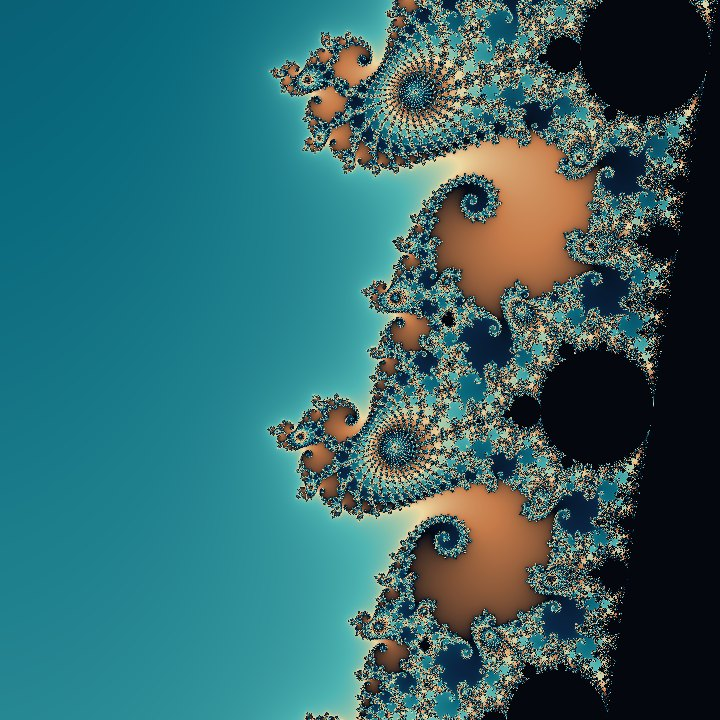

## Hi, I'm Jacob Thom

### 🌀 Fractal Rhythm — beta open on iPhone

Fractal Rhythm turns fractals into places you can fly into, and every view you find generates its own music.

- Fly into four fractal worlds (Mandelbrot, Julia, Burning Ship, Collatz), calculated live on your iPhone
- Music generated from the shape itself, in 8 styles
- Record video with sound, save stills, keep favourite places. Works offline, no account, no ads

**[Join the beta on TestFlight →](https://testflight.apple.com/join/PQr9M9Pv)** · 50 spots · free · iOS 16 or later

Website: [fractalrhythm.com](https://fractalrhythm.com) · Bugs and ideas: hello@fractalrhythm.com · [Instagram](https://www.instagram.com/fractalrhythmapp/)
